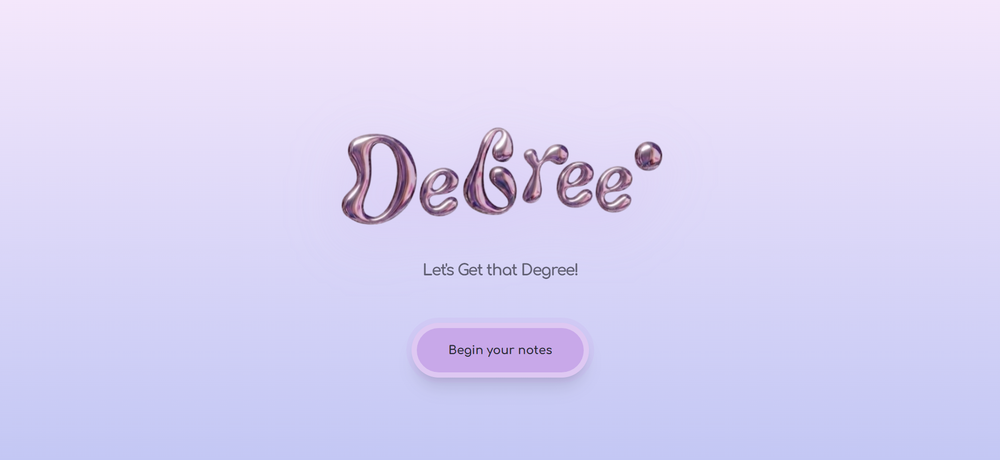
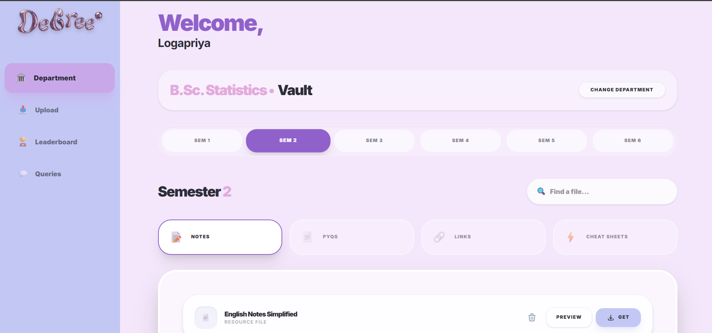
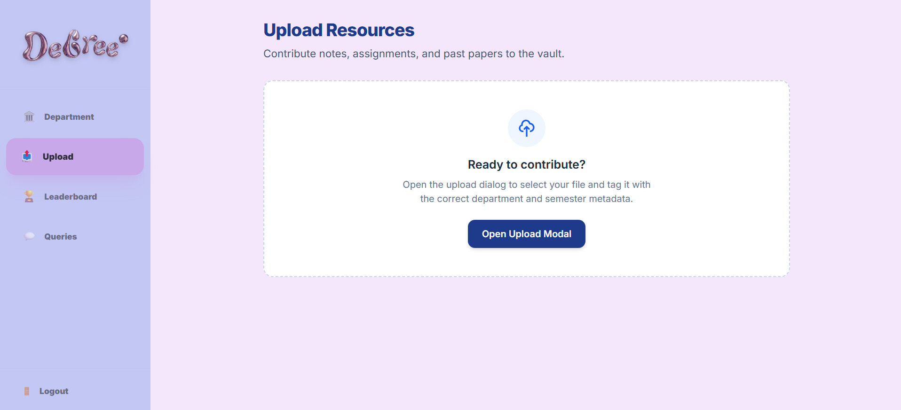
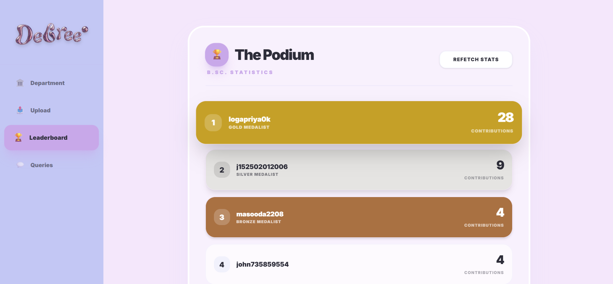
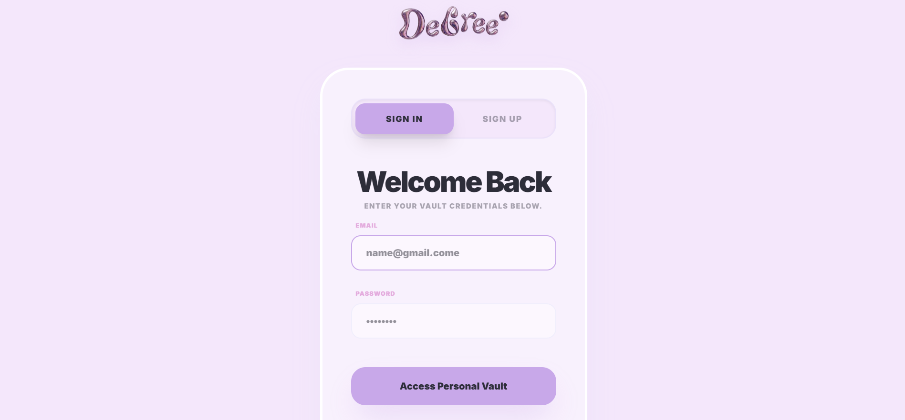
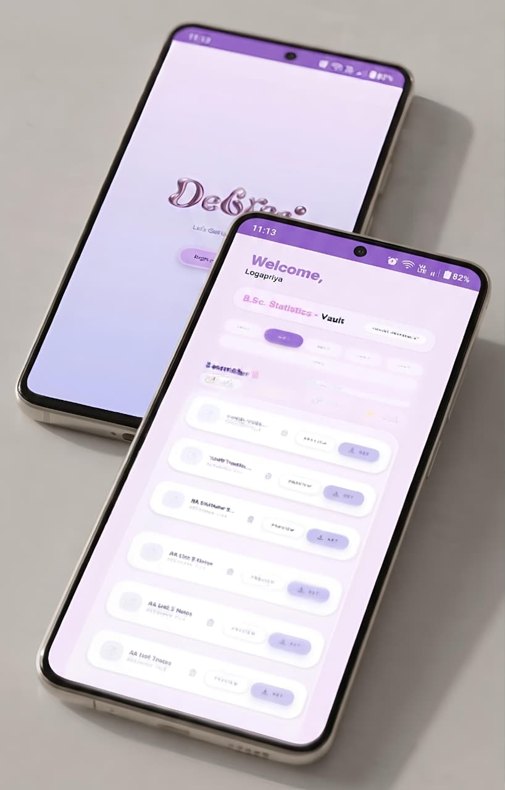
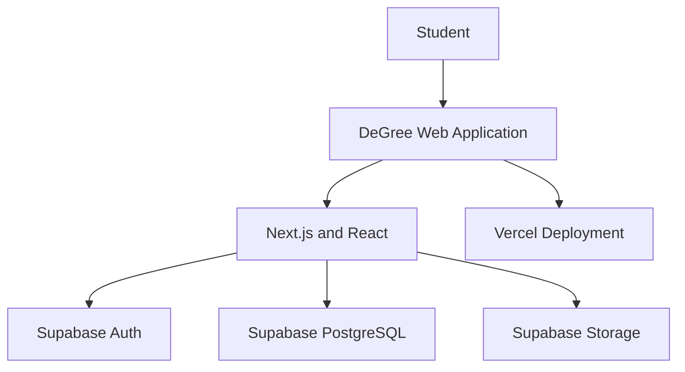

# DeGree — Academic Resource Vault


**Let's Get That Degree!**

A peer-to-peer academic resource platform built for students of **D.G. Vaishnav College, Chennai**. DeGree provides a centralised space for students to access, upload, and share academic resources across departments and semesters.

[**Live Application**](https://de-gree.vercel.app/) · [**GitHub Repository**](https://github.com/bylogapriya/DeGree)

---

## Overview

Finding reliable academic resources can be difficult when notes, previous year question papers, and other study materials are scattered across different platforms and student groups.

**DeGree** aims to address this by bringing academic resources together in one platform designed specifically for D.G. Vaishnav College students.

Students can browse resources by department, semester, and category, contribute their own materials, share external learning links, and track their contributions through a department-level leaderboard.

The application is built as a responsive Progressive Web App (PWA), making it accessible across desktop and mobile devices.

## Features

### Academic Resource Library

- Browse resources across **33 configured departments**.
- Filter resources by semester (1–6).
- Explore resources by category:
  - Notes
  - Previous Year Question Papers (PYQs)
  - External Learning Links
  - Cheat Sheets
- Filter PYQs by CIA and ESE examination types.
- Search resources by title within the loaded resource collection.

### Resource Contributions

- Upload academic files to the resource library.
- Share external learning links.
- Associate resources with a department, semester, and category.
- Store uploaded files using Supabase Storage.
- Track resource download counts.

### Student Contributions

- View a department-level contribution leaderboard.
- Identify the top 10 contributors within a department.

### Student Support

- Submit support tickets through the application.
- View responses to submitted queries.
- Admin interface for replying to and resolving support tickets.

### Authentication and User Experience

- Email and password authentication using Supabase Auth.
- Student dashboard with personalised information.
- Responsive navigation for desktop and mobile.
- Installable PWA experience.
- Open Graph metadata for link sharing.

## Screenshots

| Landing Page | Student Dashboard |
|---|---|
|  |  |

| Resource Upload | Contribution Leaderboard |
|---|---|
|  |  |

| Login Page | Mobile Dashboard |
|---|---|
|  |  |

### Student–Admin Communication


## Technology Stack

| Area | Technologies |
|---|---|
| Frontend | Next.js, React, TypeScript |
| Styling | Tailwind CSS |
| Authentication | Supabase Auth |
| Database | Supabase PostgreSQL |
| File Storage | Supabase Storage |
| Deployment | Vercel |
| PWA | Web App Manifest, Service Worker |
| Code Quality | ESLint |

## Application Architecture

DeGree uses a Next.js frontend connected to Supabase services for authentication, database operations, and file storage.



### Resource Workflow

1. A student signs in to the application.
2. The student selects a department, semester, and resource category.
3. The application retrieves matching resources.
4. Students can view, download, or contribute resources.
5. Uploaded files are stored in Supabase Storage, with resource information maintained in the database.

## Getting Started

### Prerequisites

- Node.js **20.9.0 or later**
- npm
- A Supabase project

### 1. Clone the repository

```bash
git clone https://github.com/bylogapriya/DeGree.git
cd DeGree
```

### 2. Install dependencies

```bash
npm install
```

### 3. Configure environment variables

Create a `.env.local` file in the project root:

```env
NEXT_PUBLIC_SUPABASE_URL=your_supabase_project_url
NEXT_PUBLIC_SUPABASE_ANON_KEY=your_supabase_anon_key
```

Replace the placeholders with the credentials from your own Supabase project.

**Security note:** The Supabase anon key is intended for client-side use. Database and storage access must be protected by correctly configured Row Level Security (RLS) policies. Never expose a Supabase service-role key in frontend code or public environment variables.

### 4. Configure Supabase

The application depends on Supabase for authentication, database operations, file storage, and download-count functionality.

To run the application with your own backend, you will need to configure the required database tables, access policies, storage bucket, and database function used by the application.

The repository currently does not include a complete, verified database schema or migration scripts. Therefore, configuring the environment variables alone is not sufficient to reproduce the complete backend.

### 5. Run the development server

```bash
npm run dev
```

Open [http://localhost:3000](http://localhost:3000) in your browser.

### 6. Build for production

```bash
npm run build
```

To start the production server locally:

```bash
npm start
```

## Project Structure

```text
DeGree/
├── public/
│   ├── images/
│   ├── icons/
│   ├── manifest.json
│   └── sw.js
│
├── src/
│   ├── app/
│   │   ├── api/
│   │   ├── dashboard/
│   │   ├── leaderboard/
│   │   ├── login/
│   │   ├── upload/
│   │   └── ...
│   │
│   ├── components/
│   │   ├── DashboardLayoutClient
│   │   ├── FileCard
│   │   ├── UploadModal
│   │   ├── Queries
│   │   └── ...
│   │
│   └── lib/
│       ├── supabaseClient
│       └── constants
│
├── package.json
├── package-lock.json
└── README.md
```

## Current Limitations

The following areas are not yet fully implemented:

- The chat API is currently a placeholder and does not provide functional conversational assistance.
- Offline functionality is limited; full offline resource access is not currently supported.
- Resource search is performed on the client side within the loaded collection.
- Pagination is not currently implemented.
- Profile editing, bookmarks, ratings, and notifications are not available.
- PDF and image resources open separately rather than through an integrated preview interface.

## Future Improvements

- Server-side route protection and stronger authorization.
- More comprehensive database migrations and setup documentation.
- Improved upload validation and file handling.
- Pagination and more scalable resource search.
- Enhanced offline access and caching.
- Student profile management.
- Resource bookmarking and feedback.
- Automated testing.

## Deployment

The application is deployed using **Vercel**, with the source code maintained in GitHub.

Live application: [https://de-gree.vercel.app/](https://de-gree.vercel.app/)

Deployment requires the appropriate Supabase environment variables to be configured in the hosting environment.

## About the Project

The name **DeGree** combines two ideas:

- **DG** represents D.G. Vaishnav College.
- **Degree** represents the academic qualification students work towards completing.

The name reflects the project's focus on supporting students throughout their academic journey at the college.

**Developed independently by Loga Priya K.**

B.Sc. Statistics Student  
D.G. Vaishnav College, Chennai

---

## Copyright

Copyright © 2026 Loga Priya K. All rights reserved.

This repository is publicly available for portfolio and code-review purposes. No permission is granted to copy, modify, distribute, or use the source code without prior written permission.
The easiest way to deploy your Next.js app is to use the [Vercel Platform](https://vercel.com/new?utm_medium=default-template&filter=next.js&utm_source=create-next-app&utm_campaign=create-next-app-readme) from the creators of Next.js.

Check out our [Next.js deployment documentation](https://nextjs.org/docs/app/building-your-application/deploying) for more details.
